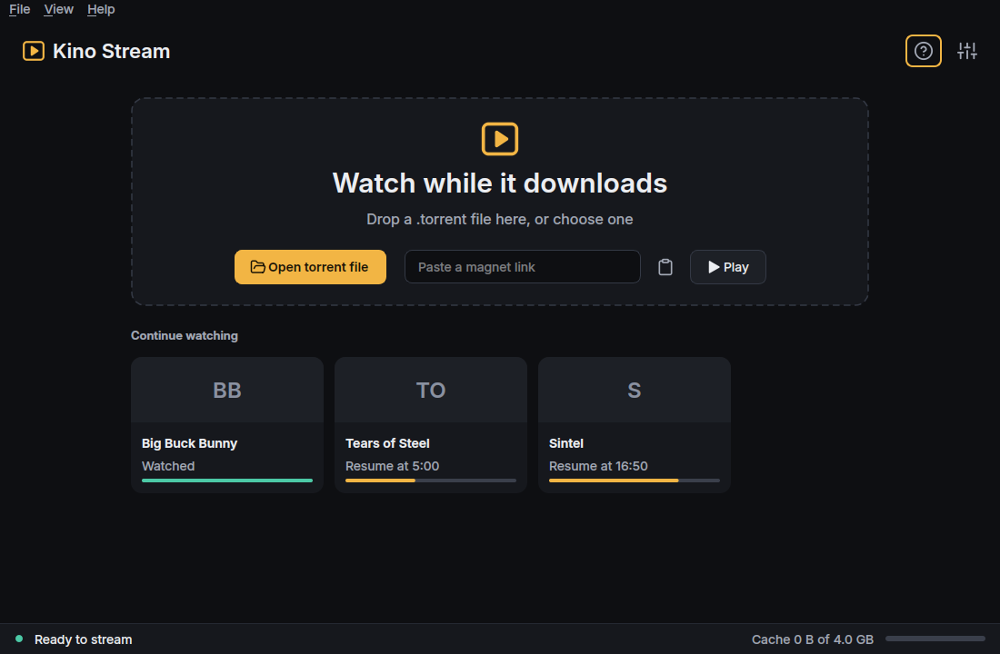
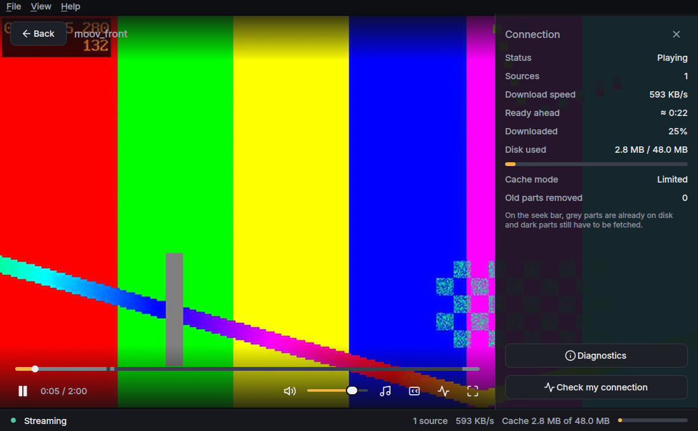

# Kino Stream

Watch a video from a torrent **while it is still downloading**, with a **hard upper limit on the disk space it uses**.
Kino Stream has a desktop app (PyQt6 + libmpv) and a command line tool that share one streaming engine.



> **Status: pre-1.0 (0.3.0), tested on Ubuntu 24.04 / GNOME / Wayland only.** The engine and cache have an extensive automated
> test suite and a few real-swarm runs, but this is young software. Read [Known limitations](#known-limitations) before relying on it.
> Kino Stream does not host or provide any content. You are responsible for only streaming material you have the right to use.

| Playing, with the connection panel | Seek bar: grey = already on disk |
|---|---|
|  |  |

## What it does

Pick a `.torrent` file or paste a magnet link and press Play. Kino Stream fetches the part of the video you are about to watch
first, plays it through mpv, and removes old parts so the cache never grows past the limit you set (4 GB by default).
How well that works depends on the people sharing the video and on your network — see [How it works](docs/HOW_IT_WORKS.md).

## Features

**Implemented and covered by automated tests**

* Desktop app: drop a `.torrent` onto the window, choose a file, or paste a magnet link; "Continue watching" list with resume.
* Embedded player (libmpv): play/pause, seek bar that shows which parts are already on disk, volume, fullscreen, audio-track and
  subtitle-track menus (tracks inside the file), keyboard shortcuts, auto-hiding controls.
* Honest status: sources, speed, how much is ready ahead, disk used, and plain-language messages for "looking for sources",
  "waiting for sources", "fetching this part", cache pressure and unsupported files.
* Hard-bounded disk cache: allocated blocks stay under the limit; evicted data is never served; crash-safe journal with recovery
  (tested with simulated crashes at every step and with real `SIGKILL`).
* Fails with a clear explanation when the filesystem cannot guarantee the limit; an explicit, warned **temporary mode** (no limit,
  deleted on close) is offered instead of silently ignoring the limit.
* Settings (cache size, how much watched video to keep, patience with poor connections, protocol encryption, on-close behaviour,
  cache folder), saved-data list with delete-on-request, first-run tutorial (reopen from Help).
* "Check my connection" and `kino-stream doctor --network`: read-only probes whose results are labelled *confirmed*, *observed*
  or *hypothesis*; it never claims a cause it has not measured.
* Desktop launcher with `.torrent` / `magnet:` handling (it does not change your default applications), single running instance.
* Command line tool: `kino-stream play ...`, `kino-stream doctor ...` (mpv in its own window).

**Not implemented / planned** (no promises)

* Translations (the code is structured for it; only English exists).
* Loading external subtitle files, choosing a file inside a multi-file torrent in the app (it plays the largest video file; the CLI has `--file`), playlists.
* Remembering the volume between sessions.
* Other operating systems, `.deb`/Flatpak packaging.
* Filesystems other than ext4 for the bounded cache (the program probes and refuses when unsafe; others are untested).
* X11 sessions (expected to work, untested).

## Install (Ubuntu 24.04)

```bash
sudo apt install python3-libtorrent python3-pyqt6 python3-pyqt6.qtsvg python3-mpv libmpv2 mpv
git clone <this repository> kino-stream && cd kino-stream
./packaging/install.sh          # user-level: no root, no network; --check shows what it would do
```

Start **Kino Stream** from the application menu, or run `kino-stream-gui`. Details, other options and the clean uninstall:
[docs/INSTALL.md](docs/INSTALL.md). Uninstall: `./packaging/uninstall.sh` (keeps your data) or `--purge-data`.

## Quick start

1. Start Kino Stream. The short tutorial appears on first launch.
2. Drop a `.torrent` file on the window, or paste a magnet link and press **Play**. Prefer `.torrent` files: magnet links depend on DHT,
   which some networks block.
3. Space pauses, ←/→ skip 5 s (Shift: 30 s), ↑/↓ volume, **F** fullscreen, **C** connection panel, **Esc** back.
4. **Settings** (top right) changes the cache size and other options.

Command line:

```bash
kino-stream play "Movie.torrent" --save-path ~/.cache/kino-stream/movie --cache-limit-gb 3
kino-stream doctor --network
```

## Documentation

* [How streaming works, and what the cache does and does not guarantee](docs/HOW_IT_WORKS.md)
* [Troubleshooting connection problems](docs/TROUBLESHOOTING.md)
* [Files and settings created, and how to remove them](docs/FILES_AND_DATA.md)
* [Install / uninstall](docs/INSTALL.md) · [CLI reference](docs/CLI.md)
* [Known limitations](docs/KNOWN_ISSUES.md) · [Changelog](CHANGELOG.md) · [Release readiness](docs/RELEASE_READINESS.md)
* Design and validation notes: [bounded cache design](docs/STAGE2_DESIGN.md), [engine validation](docs/STAGE1_VALIDATION.md), [GUI stage reports](docs/gui/)
* [Contributing](CONTRIBUTING.md) · [Security policy](SECURITY.md) · [Code of conduct](CODE_OF_CONDUCT.md)

## Known limitations

* Smooth playback is **never guaranteed**: it depends on how many people share the video, their upload speed and your network.
  Seeking into a part that is not downloaded yet waits for it (seconds on a healthy swarm, longer on a poor one).
* The disk limit is hard for *allocated blocks of the cache folder*; it is not a promise about playback during pressure
  (playback can pause while room is made) — see [How it works](docs/HOW_IT_WORKS.md#what-the-cache-limit-guarantees).
* Tested on ext4 only, on one Ubuntu 24.04 machine, Wayland. Real-swarm validation consists of a handful of runs.
* One intermittent failure of an automated magnet-link test (2 of ~14 early runs, not reproduced in 40+ later runs) has an
  **unknown root cause**; details in [docs/KNOWN_ISSUES.md](docs/KNOWN_ISSUES.md).
* Every eviction re-adds the torrent in libtorrent, which drops peer connections briefly; the effect on slow real swarms is not
  fully measured.

## Tests

```bash
python3 -m unittest discover -s tests -t .      # everything except the OpenGL player tests (~12 min, needs mpv + ffmpeg)
python3 -m unittest tests.test_ui_player        # real libmpv/OpenGL player on a graphical session (~45 s; a window appears)
```

See [CONTRIBUTING.md](CONTRIBUTING.md) for the test layout. Opt-in heavy tools: `tests/large_scenarios.py` (25 GB files),
`tests/realswarm.py` (uses the internet), `diag/` (network diagnostics, stress tools).

## License

Not yet chosen — see [docs/LICENSE_DECISION.md](docs/LICENSE_DECISION.md). Until a `LICENSE` file is added, no one but the author has
permission to copy or modify this code.
