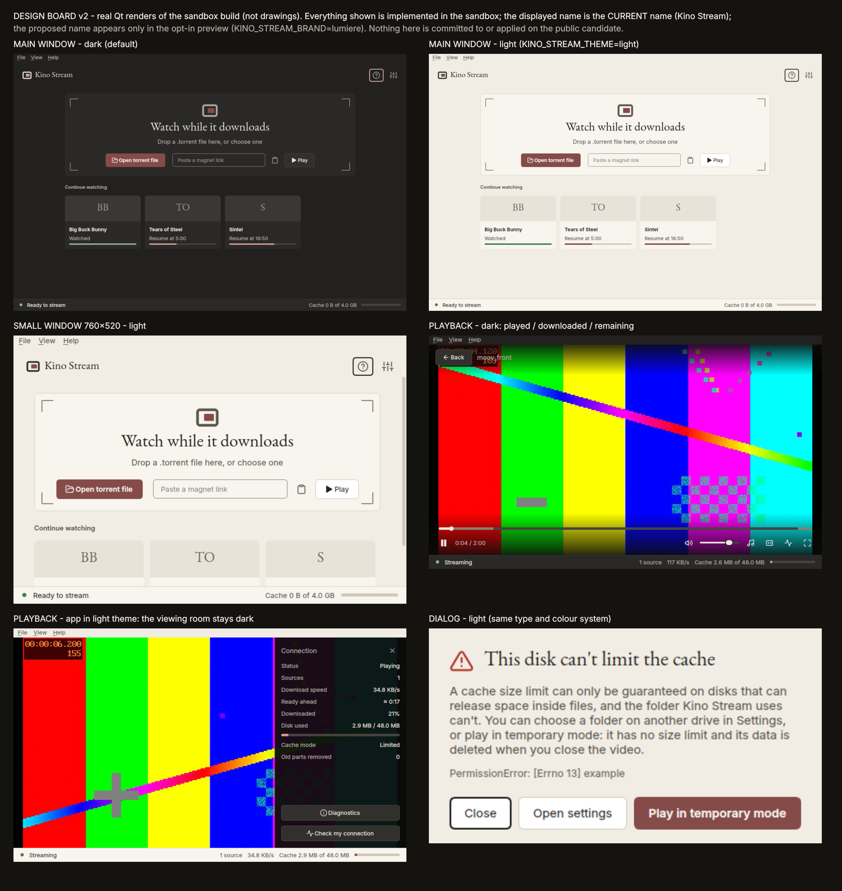

# Lumière — design concept and sandbox implementation (v2, refinement phase)

> **Status (2026-10-10): the design direction is adopted and implemented in the release candidate** (the name Lumière is applied; see `docs/NAMING.md`). This document is the design record and still contains the earlier exploration. It originally read: "provisional design direction, implemented in a sandbox, not adopted"; the owner had provisionally approved the *visual direction* for further refinement (charcoal and warm ivory, restrained burgundy, olive grey for secondary status, selective editorial serif, frame symbol + wordmark, always-dark playback).
> **Update 2026-10-10:** Lumière is now the displayed product name (owner decision); it has still **not** been checked for trademark or domain availability. Earlier text: "the displayed name stays Kino Stream unless `KINO_STREAM_BRAND=lumiere` is set"; today the switch is reversed (`KINO_STREAM_BRAND=kino` shows the old name). No technical identifier is renamed.
> Nothing here is committed to, merged into or installed from the public release candidate; the sandbox is a local working copy (not part of this repository).



*(Real Qt renders of the sandbox build. Logo explorations: [concept_logo_explorations.png](concept_logo_explorations.png) — concepts only. Small-size icon study: [icon_small_size_evaluation.png](icon_small_size_evaluation.png). Wordmark at real size: [wordmark_in_use.png](wordmark_in_use.png).)*

## 1. Concept
*A contemporary European cinematheque, designed for everyday use.* A quiet room, a dark screen, one warm accent used sparingly, an editorial serif only for the brand and a few headings, plain practical sans for everything you press.
The playback surface is neutral (near-black, no colour cast, no texture, no persistent branding) and stays dark in both app themes.

## 2. Design system (`kino_stream_ui/theme.py`)
Brand colours are kept verbatim — charcoal `#22211F`, ivory `#F1EDE4`, burgundy `#854B49`, olive grey `#85836F`, soft white `#EAE7E0`, warm grey `#AAA59F` — and completed with derived tokens where the raw values fail contrast
(burgundy on charcoal is 2.37:1, warm grey on ivory 2.09:1). `ACCENT_FILL` is the verbatim burgundy (fills only, under `ON_ACCENT` text); `ACCENT` is the accent you can *read* on the current background (rose tint on dark, burgundy on ivory);
`FOCUS` + `FOCUS_INNER` are the two bands of the focus ring; `OUTLINE_STRONG` is for control boundaries that must be perceivable; `PLAYED` is the seek bar's "already watched" layer; olive grey is the "already on disk" layer and the secondary-status tone.
Theme choice stays an environment variable (`KINO_STREAM_THEME=dark|light`, read when the theme module is first imported; **no persisted setting**, no live switching). Widgets now read tokens when they are *built* (several were frozen at import time through default arguments; fixed).

| token | dark | light |
|---|---|---|
| BG | `#22211F` | `#F1EDE4` |
| SURFACE | `#2A2927` | `#F8F5EE` |
| ELEVATED | `#32302D` | `#FFFFFF` |
| CANVAS | `#0C0C0B` | `#0C0C0B` |
| OUTLINE | `#4A4742` | `#CFC8B9` |
| OUTLINE_STRONG | `#8C8780` | `#8A847A` |
| HAIRLINE | `#35332F` | `#D9D3C6` |
| HOVER | `#3A3835` | `#E8E3D8` |
| PRESSED | `#43403C` | `#DDD6C8` |
| TEXT | `#EAE7E0` | `#22211F` |
| TEXT2 | `#AAA59F` | `#59554F` |
| TEXT3 | `#9C978F` | `#6B665F` |
| ACCENT | `#D49A96` | `#854B49` |
| ACCENT_FILL | `#854B49` | `#854B49` |
| ACCENT_HOVER | `#9A5A57` | `#733F3D` |
| ACCENT_PRESSED | `#6F3F3D` | `#613331` |
| ON_ACCENT | `#F5F2EC` | `#FBF8F2` |
| FOCUS | `#E3B9B5` | `#22211F` |
| FOCUS_INNER | `#F5F2EC` | `#FBF8F2` |
| SECONDARY | `#85836F` | `#6E6C58` |
| SUCCESS | `#8DB596` | `#3F7A52` |
| WARNING | `#D1AA63` | `#8A6212` |
| DANGER | `#E7786A` | `#B13A2E` |
| TRACK | `#46433E` | `#CFC8B9` |
| AVAILABLE | `#85836F` | `#6E6C58` |
| PLAYED | `#EAE7E0` | `#22211F` |

**Contrast (asserted in `tests/test_theme.py`; WCAG 2.1 AA: 4.5 text, 3.0 non-text/large text)**

| pair (foreground on background) | dark | light | needs |
|---|---|---|---|
| TEXT on BG | 13.03 | 13.77 | 4.5 |
| TEXT on SURFACE | 11.77 | 14.78 | 4.5 |
| TEXT on ELEVATED | 10.65 | 16.09 | 4.5 |
| TEXT on HOVER | 9.46 | 12.57 | 4.5 |
| TEXT2 on BG | 6.58 | 6.34 | 4.5 |
| TEXT2 on SURFACE | 5.95 | 6.80 | 4.5 |
| TEXT3 on BG | 5.54 | 4.87 | 4.5 |
| TEXT3 on SURFACE | 5.01 | 5.23 | 4.5 |
| ON_ACCENT on ACCENT_FILL | 6.06 | 6.39 | 4.5 |
| ON_ACCENT on ACCENT_HOVER | 4.73 | 7.90 | 4.5 |
| ON_ACCENT on ACCENT_PRESSED | 7.66 | 9.78 | 4.5 |
| ACCENT on BG | 6.79 | 5.80 | 4.5 |
| ACCENT on SURFACE | 6.13 | 6.22 | 4.5 |
| SUCCESS on SURFACE | 6.36 | 4.68 | 4.5 |
| WARNING on SURFACE | 6.67 | 5.03 | 4.5 |
| DANGER on SURFACE | 5.05 | 5.49 | 4.5 |
| FOCUS on BG | 9.10 | 13.77 | 3 |
| FOCUS on ELEVATED | 7.44 | 16.09 | 3 |
| OUTLINE_STRONG on BG | 4.51 | 3.17 | 3 |
| OUTLINE_STRONG on SURFACE | 4.08 | 3.41 | 3 |
| OUTLINE_STRONG on ELEVATED | 3.69 | 3.71 | 3 |
| ACCENT on TRACK | 4.16 | 4.07 | 3 |
| AVAILABLE on TRACK | 2.57 | 3.19 | 1.5 |

**Typography.** Interface: Inter → Cantarell → Noto Sans → Ubuntu → DejaVu Sans. Editorial serif (wordmark, hero/page titles, card initials): first installed of Literata, Source Serif 4, EB Garamond, Charis SIL, Noto Serif, Liberation Serif, DejaVu Serif. **No font is bundled** (decision: keep the system-font strategy until licensing, attribution, packaging and benefit are reviewed).
Literata and Source Serif 4 are not installed on the development machine, so EB Garamond renders here; on another machine a different serif appears, so the serif look is *not guaranteed identical across machines*.
**Shape.** Modest radii (controls 6 px, cards 8 px; previously 8/12), flat cards without shadows, banners as flat strips with a coloured rule, the drop zone as a hairline frame with four film-gate corner marks (accent while a file is dragged over it).

## 3. Accessibility review (this phase)
**Criteria applied.** WCAG 2.1/2.2: 1.4.3 text contrast (4.5:1); 1.4.11 non-text contrast (3:1 for UI component boundaries and states — for a focus indicator, 3:1 against *every* adjacent colour: the page outside the ring and the fill inside it); 2.4.7 Focus Visible (AA); 2.4.13 Focus Appearance (AAA in WCAG 2.2: at least 2 px thick, 3:1 between focused and unfocused), targeted where reachable.
Disabled controls are exempt from contrast rules but were checked for legibility and distinguishability; hover is not a WCAG contrast criterion and was checked for being perceivable. **Not assessed:** 2.4.11 Focus Not Obscured, screen readers, high-contrast OS modes, OS text scaling.

**Light-theme focus ring (the 2.37:1 finding).** The ring (2 px) is drawn next to two colours: the page outside and, on primary buttons and checked segments, the burgundy fill inside. A single dark ring is 13.8:1 against ivory but only 2.37:1 against the fill. Fix: a **two-band ring** — the style sheet's 2 px outer band (`FOCUS`) plus a 1.5 px inner band (`FOCUS_INNER`) painted by `ActionButton` on filled buttons. Measured on the rendered pixels:

| theme | outer band vs page | inner band vs burgundy fill | inner band vs unfocused edge | old single ring vs fill |
|---|---|---|---|---|
| light | 13.77 | 6.39 | 6.39 | 2.37 |
| dark | 9.10 | 6.06 | 6.06 | 3.83 |

Remaining honesty: the outer *charcoal* band alone is still 2.37:1 against the unfocused fill; the focus indicator as a whole (3.5 px) is ≥3:1 against both neighbours and against the unfocused state through its inner band. Tests: `tests/test_accessibility.py::RenderedFocus*` sample the actual pixels in both themes.

**Two keyboard-focus defects found by a sweep of every focusable control (Home and Settings, both themes), present in the PUBLIC build too:** the recent-video cards (`RecentCard`) accept focus and Enter/Space but showed **no visible focus at all** (0 changed pixels), and each screen's scroll area was an **invisible Tab stop** (0 changed pixels).
Fixed in the sandbox: cards draw the ring; the scroll areas no longer take focus (their children do, and Qt scrolls a focused child into view). Behaviour change to note: one fewer Tab stop per screen. Verified by running the same comparison on the unmodified public build (defects) and the sandbox (all controls visibly change when focused).

**Hover, pressed, disabled.** Hover vs rest 1.13 (dark) / 1.28 (light); pressed vs hover 1.13; primary-button hover vs rest 1.28 / 1.24 — perceivable but subtle (not a WCAG requirement). Disabled text on its surface 5.01 / 5.23:1 (legible) against enabled text 11.77 / 14.78:1 (clearly different).

**Played / downloaded / remaining on the seek bar.** The played layer was a rose tint, only 1.62:1 against the olive "downloaded" layer — distinguishable by hue alone, which fails for some colour-vision deficiencies. It is now soft white (`PLAYED`): played vs downloaded **3.11**, downloaded vs remaining **2.57**, played vs remaining **7.97** — three luminance steps, so order does not depend on hue. The volume slider uses the same tone. The seek bar is identical in both app themes (the player always uses the dark set).
Evaluated alternatives: rose tint (keeps the accent, fails the luminance separation) vs soft white (neutral: also does not tint the film). Chosen: soft white.
Tests: `tests/test_accessibility.py::SeekBarRendering*` render the real widget and compare the three layers' luminance order and contrast.

**Text contrast, both themes:** all text pairs ≥ 4.5:1 (table above); the lowest is TEXT3 on SURFACE at 5.01 (dark) / 5.23 (light).

## 4. Logo, icon and wordmark

> **Update:** the outlined wordmark (concept C) and its generator `tools/make_brand_assets.py` were removed after the release candidate: the header name is plain text in the system serif, which keeps the project free of font-derived artwork and of a maintenance burden. Passages below that mention the asset describe the exploration. The frame symbol and the icon (plain geometry) are unchanged.
| concept | idea | verdict |
|---|---|---|
| A — Frame | a frame (19:15) with a lit panel inside | **chosen** (two shapes, works in one colour) |
| B — Light | the frame crossed by a beam | busier at 16–24 px; exploration only |
| C — Wordmark | "Lumière" in an outlined editorial serif | **chosen** for headers; the symbol alone is the icon |

**Does the icon read clearly at small sizes? (measured on the shipped SVG)** The first geometry did not hold up at 16–24 px (frame stroke ≈1 px, antialiased to a dim grey line). The geometry was changed (frame stroke 2.0 → 2.6 on the 24-unit grid, larger lit panel, near full-bleed tile, one shared definition in `brand.py`):

| size | solid frame pixels old → new | lit-panel pixels old → new |
|---|---|---|
| 16 px | 0 → 12 | 8 → 12 |
| 22 px | 16 → 52 | 24 → 24 |
| 24 px | 28 → 56 | 24 → 35 |
| 32 px | 60 → 140 | 53 → 69 |
| 48 px | 188 → 320 | 117 → 163 |

Assessment: at 22 px and above the icon is clearly a frame with a lit panel; at 16 px it is recognisable as a framed block with a bright centre but has little detail (12 lit pixels) — adequate for a panel/tray icon, not rich. It has no literal cinema cue beyond proportion and can read as a generic screen; that is the price of the restraint requested. Four tile variants were compared; the rose-tint panel on charcoal reads best; monochrome is the fallback.
Tests: `SmallSizeLegibility` (pixel counts at 16/22/24/32/48 px).

**Is the wordmark legible in actual use?** Rendered at the real header height (26 px) the capital L's stem is 3 px wide and the grave accent of the è has 19–23 pixels at ≥3:1 contrast (peak 13:1) in both themes; below 20 px the accent shrinks to 7–15 pixels. **Guideline: use the wordmark at 20 px or taller; below that use the symbol alone.** The strokes are thin (a light-weight garalde): readable on ordinary screens, fine on high-DPI, least forgiving on low-DPI small sizes. Tests: wordmark stem/accent thresholds at 20/26/32 px.
Assets: `kino_stream_ui/assets/lumiere-wordmark.svg` (outlined, `currentColor`), `packaging/kino-stream.svg` (app icon, no text, so it suits either name), `kino_stream_ui/brand.py`, `tools/make_brand_assets.py`.

**Adoption view on the identity (recommendation, not a decision):** the icon is acceptable from 22 px up and marginal at 16 px; the wordmark is legible at its intended sizes. Neither needs to block adoption of the direction; the 16 px case and the "generic screen" reading are the weak points to review.

## 5. Refinements made in this phase (sandbox)
Main-window hierarchy and spacing (header offset, modest radii, empty-state text from caption to readable secondary), flat banner strip, consistent dialog and card shapes, soft-white played layer and volume slider, two-band focus ring, visible focus on cards, no invisible scroll-area stop, stronger small-size icon geometry, tokens read at build time. After the refinements I re-rendered and inspected Home (1100×720 and the small 760×520 window), the banner, empty state, dialogs and tutorial in both themes, and playback on the real Wayland display in both app themes at 1100×680 and 720×480; Settings was rendered in both themes but only the Settings layout tests (no overflow at the minimum size), not a fresh visual pass, cover the small window since the refinements.
*Not added (by instruction):* an About dialog, a theme setting, any new functionality.

## 6. Themes
Both themes render consistently across Home, Settings, dialogs, banner, tutorial and empty state; the playback area is dark in both (screenshots: dark app, light app). The theme module is selected once at start-up from `KINO_STREAM_THEME`.

## 7. Naming and migration

> **Update 2026-10-10:** the owner decided that the product is called Lumière. Only the display name was changed (`brand.product_name()`, desktop entry `Name=`, texts); the identifiers described below stay as they are. Trademark/domain checks remain outstanding. The text below is the earlier analysis. (nothing renamed; trademark not checked)
| identifier | role | rename needed for a display change? | if "Lumière" is approved |
|---|---|---|---|
| window title, headers, dialog text | display | yes — switchable via `brand.product_name()` | change the default in one place |
| `Name=` in the desktop entry, README, docs | display | yes | change with the above |
| `kino_stream`, `kino_stream_ui` | technical | **no** | keep |
| `kino-stream`, `kino-stream-gui` commands | technical | no | keep; optional aliases later |
| `kino-stream.desktop`, `StartupWMClass`, `Icon=` | launcher id | no | keep the id |
| `…/kino-stream/` config, state, cache directories | **user data** | no | keep; any rename needs a non-destructive, verified migration |
| single-instance socket, `magnet:`/`.torrent` handlers | technical | no | keep |

**Checks still required before any public use of the name** (none performed): trademark search in the target jurisdictions and relevant classes (software, audio-visual/streaming; "Lumière" is a common word, a historic film name and an existing brand in several fields); domain and package-name availability; app-store/distribution-name conflicts; existing open-source projects with the same name; a review by a qualified person.

## 8. Fonts and licensing (accurate record)
* **No font is bundled.** The identity uses system fonts with fallbacks. Bundling is deferred until licence, attribution, packaging requirements and visual benefit are reviewed.
* **How the wordmark was made:** `QT_QPA_PLATFORM=offscreen python3 tools/make_brand_assets.py --write` asks Qt for the locally installed family "EB Garamond", which Qt resolved to the style **"EB Garamond 12 Regular"** (file `/usr/share/fonts/truetype/ebgaramond/EBGaramond12-Regular.ttf`, SHA-256 `689aa494b0eb1913…`, Ubuntu package `fonts-ebgaramond-extra` 0.016+git20210310.42d4f9f2-1), sets "Lumière" at 100 px with +2.5 letter spacing, converts the glyph outlines into one SVG path, and writes `kino_stream_ui/assets/lumiere-wordmark.svg` (SHA-256 `c3a39ab2…`; no `<text>`, no font reference). The result depends on the installed font; `--font FAMILY` selects another locally installed family.
* **Licence of the font:** SIL Open Font License 1.1, © 2010–2012 Georg Duffner (per `/usr/share/doc/fonts-ebgaramond-extra/copyright`). No font file is copied or distributed; the SVG is vector artwork made with the font. **Whether outlined lettering counts as a derivative of the font, and what attribution the OFL requires for it, is a question for qualified review — no legal conclusion is claimed.** If it is a concern, set the wordmark in a different typeface and regenerate it.
* The symbol and the icon are plain geometry drawn for this project. Notices: `THIRD_PARTY_NOTICES.md`.

## 9. Decisions and risks for the owner
1. Adopt the identity (it changes the default look)? Reversible: the delta is a patch/tarball; nothing is applied to the public candidate.
2. Rename? Only after the trademark and naming checks in §7.
3. Bundle a serif for a consistent look? Not without a licence/packaging review.
4. A Settings → Appearance toggle (new persisted setting) — not built.
5. Ship the new application icon (existing installs see it after reinstalling)?
6. Keep or change the playback window chrome in the light theme (currently ivory around the dark viewing area)?
7. The two keyboard-focus defects exist in the public candidate; their fixes live only in this delta.

## 10. Test results
Environment: Ubuntu 24.04, GNOME/Wayland, Python 3.12, PyQt6 6.6.1 on Qt 6.4.2. All results are for the sandbox tree; none for the public candidate.

| run | command | exit | result |
|---|---|---|---|
| full discovery, run 1 | `python3 -m unittest discover -s tests -t .` | **139 (SIGSEGV)** | **crashed**: killed by signal 11 inside `tests.test_ui.Window.test_open_failure_maps_to_dialog_and_hides_overlay` after ~150 tests had passed; no summary line, **no stack trace** (the tracer was not enabled for this run) |
| full discovery, run 2 | same, with `python3 -X faulthandler` | 0 | **211 tests, OK, 7 skipped**, 775.7 s |
| real-display player tests | `python3 -m unittest -v tests.test_ui_player` (Wayland, OpenGL) | 0 | 9 tests OK, 54.7 s |
| GUI-module loop | `tests.test_accessibility test_theme test_launch test_tour test_ui` ×30, tracer on | 0 ×30 | 30/30 clean |
| GUI + service subset in discovery order | 9 modules, tracer on | 0 | 110 tests OK, 88 s |
| theme + accessibility (new) | `tests.test_theme tests.test_accessibility` | 0 | 31 tests OK (20 + 11) |
| installer path handling / stall detector / cache restart reuse (carried and new) | inside the full runs | 0 | pass |
| confirmation runs 1–3 (crash investigation) | `ulimit -c unlimited; python3 -X faulthandler -m unittest discover -s tests -t . -v`, run **sequentially** by a script, machine otherwise idle (only document editing in between) | 0, 0, 0 | **211 tests, OK, 7 skipped each**; 690.6 s, 688.5 s, 704.2 s; no "Fatal Python error" in any log; no core file was written |

**The segfault is unresolved — intermittent, not reproduced, not fixed.** *(Update, later phase: 2 more full runs on the final tree passed, both under deliberate concurrent load, with the tracer on and core dumps enabled; see `PHASE0_AND_INTERACTION_IMPLEMENTATION.md` §5 and the maintainer's local crash-investigation archive (not part of this repository). Tally at that point: 8 full runs, 1 crash, 7 passes.)* Tally at the time of this paragraph: **5 full discovery runs, 1 crashed (exit 139) and 4 passed** (211 tests, 7 skipped, exit 0), plus 30/30 clean loops of the GUI modules and a clean 110-test subset in discovery order. The one crash happened in a GUI test that passes alone (0.3 s), in its module (10 tests) and in every loop; its stack was **not captured** (the tracer was off), so neither the cause nor any relation to the design changes (new painting code in `ActionButton`/`RecentCard`; new accessibility tests that create and close windows) is known.
*Conditions that differed:* the crashed run overlapped with several other Qt processes that I was running at the same time (screenshot, measurement and table scripts); the four clean runs ran with the machine otherwise idle (the tracer being on is the other difference). That is suggestive of a concurrency or load sensitivity and is **not** evidence of one. The public candidate passed all of its earlier full runs, none of which included this code — also suggestive, not conclusive.
The project must therefore **not be described as passing the full regression reliably**: the most recent four consecutive full runs passed, one earlier full run crashed, and the cause is open. A reproduction attempt that stresses concurrent Qt processes with the tracer on is the proposed next step.
*Cache-test investigation:* see `docs/investigations/CACHE_RESTART_TEST.md` (mechanism identified; no cache-limit violation; a deterministic replacement test was added; the original test is untouched).


## 11. Preview it
```bash
cd a local working copy (not part of this repository)
python3 -m kino_stream_ui                                              # dark, current name
KINO_STREAM_THEME=light python3 -m kino_stream_ui                      # ivory theme
python3 -m kino_stream_ui                                              # Lumière (default since 2026-10-10)
KINO_STREAM_BRAND=kino python3 -m kino_stream_ui                       # previous display name
python3 tools/make_brand_assets.py --write --sheet docs/design/concept_logo_explorations.png
```
